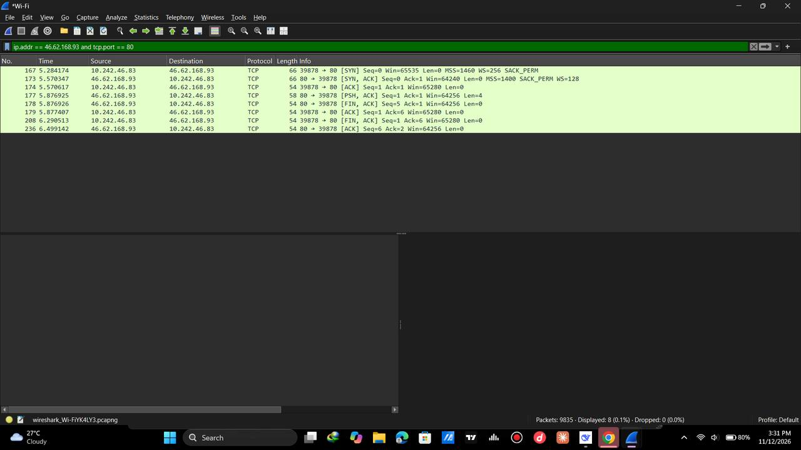
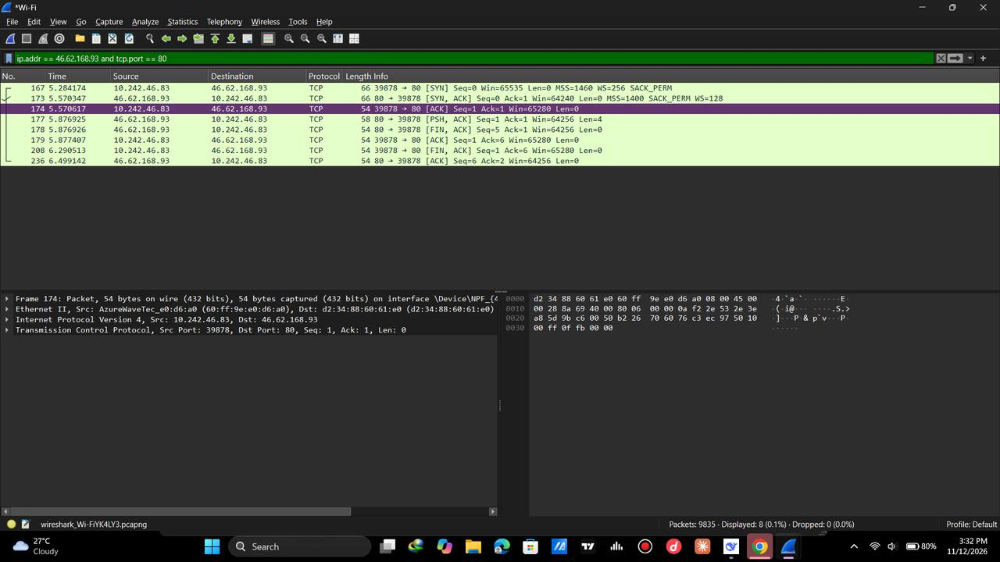
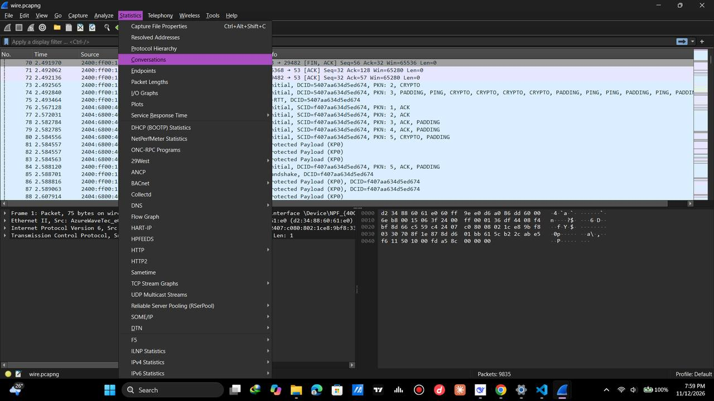
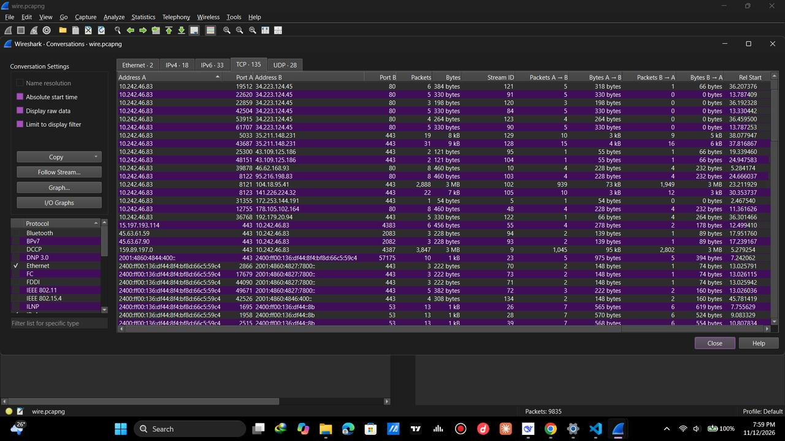
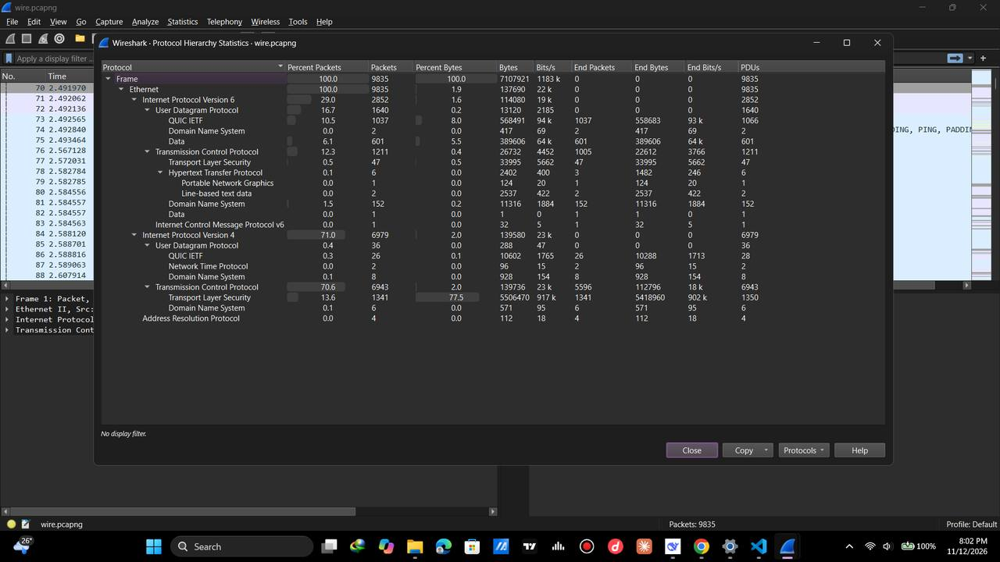
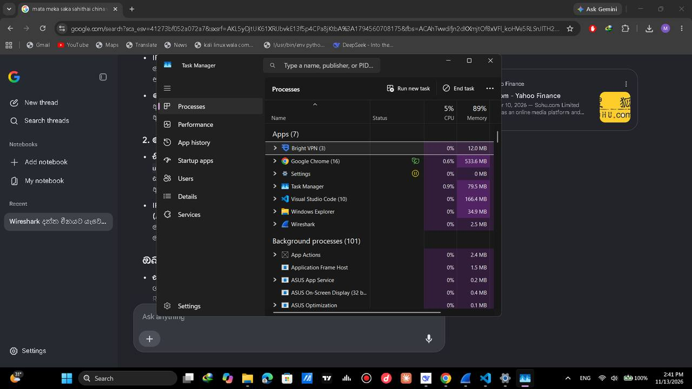
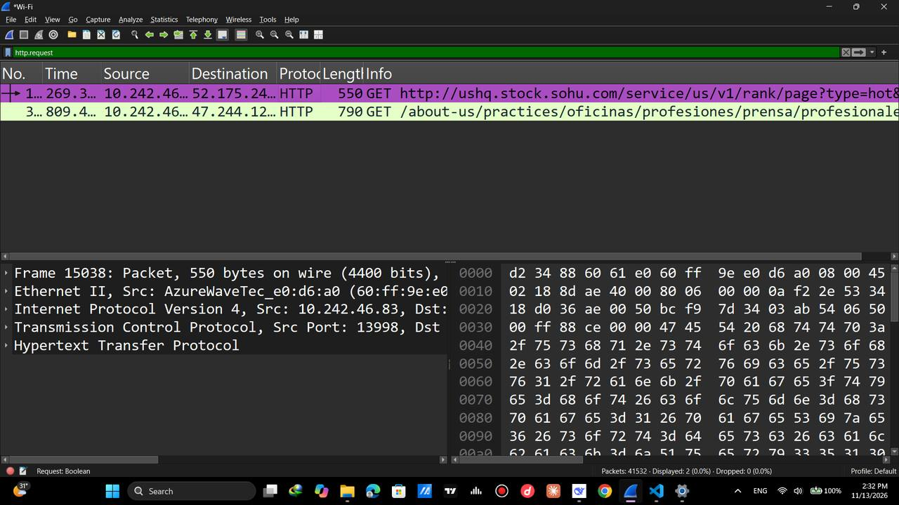
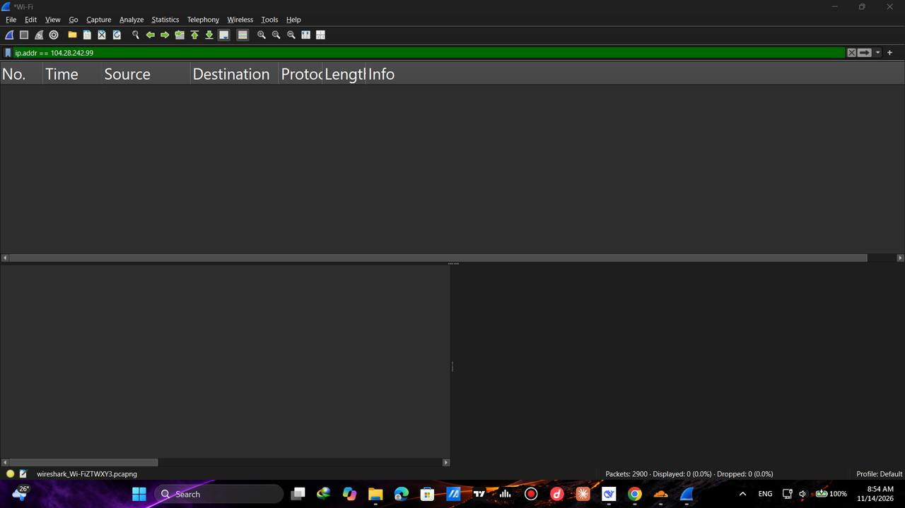

# Wireshark — Easy Writeup (ඕනෑම කෙනෙකුට තේරෙන විදියට)

**Author:** Malith Lakshan Wijekoon
**Tool:** Wireshark
**Website Tested:** neverssl.com
**Date:** 2026-11-12/13

---

## 1. Wireshark කියන්නේ මොකක්ද?

ඔයාගේ Computer එකෙන් Internet එකට යවන හැම "packet" එකක්ම (කුඩා data කැබැල්ලක්) **Wireshark** එකෙන් අල්ලගන්න/බලන්න පුළුවන්. හිතන්න මේක **post office එකක CCTV camera එකක්** වගේ — එතනින් යන හැම letter එකක්ම (packet එක), එයාට කවුද යවන්නේ, කොහෙද යවන්නේ, ඇතුළේ මොකද්ද තියෙන්නේ කියලා බලාගන්න පුළුවන්.

මේ lab එකේදී, අපි ගියේ **`neverssl.com`** කියන ලස්සන website එකකට — මේක **intentionally HTTPS (lock icon) නැතුව** තියෙන site එකක්, ඒ නිසා traffic එක **plain text** එකේ බලන්න පුළුවන් (practice කරන්න specially හදපු site එකක්).

---

## 2. Connection එකක් පටන් ගන්නේ කොහොමද? (3-Way Handshake)

Browser එකකින් website එකකට connect වෙද්දී, **"hello" කතාවක් 3ක්** හරියට සිද්ධ වෙනවා:

1. **[SYN]** — ඔයාගේ Computer එක කියනවා: **"Hi, Connect වෙන්න පුළුවන්ද?"**
2. **[SYN, ACK]** — Server එක පිළිතුරු දෙනවා: **"ඔව්, මටත් ඕන, ඔයාත් එකඟද?"**
3. **[ACK]** — ඔයාගේ Computer එක කියනවා: **"ඔව්, හරි!"**

මේ 3 step එකටම කියනවා **3-Way Handshake** කියලා. මේක ඉවර වුණාට පස්සේ විතරයි **ඇත්තම දත්ත** (actual webpage) යවන්න පටන් ගන්නේ.



*මේ picture එකේ පේනවා: පළවෙනි line එකේ `[SYN]`, දෙවෙනි line එකේ `[SYN, ACK]`, තුන්වෙනි line එකේ `[ACK]` — ඒ තුනම connection එකක් successfully පටන් ගත්තා කියන එකේ සංඥා.*

**තව flags කීපයක් (simple):**
- **[PSH, ACK]** — "මේ data ටික ඉක්මනින් භාරගන්න" කියන එක
- **[FIN, ACK]** — "අපි ඉවරයි, connection එක close කරමු" කියන එක

---

## 3. HTTP Request/Response — Browser එක Website එකෙන් මොකද්ද ඉල්ලන්නේ?

Connection එක established වුණාට පස්සේ, Browser එක Server එකට මෙහෙම ඉල්ලීමක් කරනවා:

```
GET /online HTTP/1.1
```

**සරලව කිව්වොත්:** "මට `/online` කියන page එක දෙන්න."

Server එකෙන් ලැබෙන පිළිතුර 2ක් තිබුණා:

1. **301 Moved Permanently** — "මේ page එක මෙතන නෑ, ඒත් වෙන address එකක තියෙනවා, එතනට යන්න"
2. **200 OK** — "ඔන්න, page එක මෙන්න, සාර්ථකයි"



*මේ picture එකේ Wireshark එකේ `http` filter එකෙන් filter කරලා පෙන්නන්නේ: `GET /online`, `301 Moved Permanently`, `GET /online/`, `200 OK`, ඊට පස්සේ `GET /favicon.ico` (website එකේ icon එකත් වෙනම download වෙනවා).*

**Server එකේ වැදගත් Secret එකක් expose වුණා:**

```
Server: Apache/2.4.68 ()
Content-Type: text/html; charset=UTF-8
```

මේකෙන් කියන්නේ "මම **Apache** කියන web server software එකේ **version 2.4.68** එක run කරනවා" කියලා. ඒක ඇයි දැනගන්න ඕනද? — **Hacker කෙනෙකුට** මේ version number එක දැනගත්තොත්, ඒ specific version එකේ තියෙන known security holes (vulnerabilities) ගැන search කරලා, attack එකක් plan කරගන්න පුළුවන්. මේකට කියනවා **"Information Disclosure"** කියලා.

---

## 4. DNS — Website එකේ "ලිපිනය" හොයාගන්නේ කොහොමද?

`neverssl.com` වගේ නම (domain name) එකක් browser එකේ type කරාම, Computer එකට ඒකේ **ඇත්ත IP address එක** දැනගන්න ඕන (letter එකක් යවන්න නම් address එක ඕන වගේ). මේකට use කරන්නේ **DNS (Domain Name System)**.



**සරලව කතාව:**
1. Computer එක අහනවා: **"neverssl.com ගේ IP address එක මොකක්ද?"**
2. DNS Server එක උත්තර දෙනවා: **"34.223.124.45"** (මේක තමයි neverssl.com ගේ ඇත්ත ලිපිනය)

මේකට **"A record"** කියනවා — IPv4 address එකක් ඉල්ලන query එකක් (IPv6 address එකක් ඉල්ලනවා නම්, ඒකට කියනවා "AAAA record" කියලා).

---

## 5. Website එකක ඉඳන් File එකක් "බේරාගැනීම" (Export Objects)

Wireshark එකේ තියෙනවා **"Export Objects"** කියන feature එකක් — ඔයා capture කරපු traffic එකේ ඇතුළේ images, files ගියා නම්, ඒවා **extract කරලා, ඔයාගේ computer එකට save කරගන්න** පුළුවන්.



**මෙහෙම කරනවා:**
1. Wireshark එකේ `http` filter එක දානවා
2. Menu එකේ **File → Export Objects → HTTP...** එකට යනවා
3. List එකේ ඕන file එක (උදා: `favicon.ico`, size 124 bytes) select කරලා **Save** කරනවා

**ඇයි මේක වැදගත්ද?** Security investigation එකක (incident response) දී, suspicious network traffic එකක් capture වෙලා තියෙනවා නම්, එතනින් **actual files** (documents, images, malware pieces) extract කරලා analyze කරන්න මේ feature එකම use කරනවා.

---

## 6. Traffic ගොඩක් තියෙද්දී ඉක්මනින් Summary එකක් බලාගන්නේ කොහොමද? (Statistics)

Capture file එකක packets 9000කට වඩා තිබුණොත්, එකින් එක බලන එක ප්‍රායෝගික නැහැ. ඒ වෙනුවට Wireshark එකේ **Statistics menu** එකෙන් ඉක්මනින් "overall picture" එක බලාගන්න පුළුවන්.



**Protocol Hierarchy** කියන window එකෙන් පෙන්වන්නේ: **traffic එකෙන් වැඩිම ප්‍රමාණය කුමන protocol එකටද** (TLS ද, DNS ද, QUIC ද...) කියලා percentage එකක් විදියට. මේකෙන් "මේ network එකේ වැඩියෙන්ම දුවන්නේ මොකක්ද" කියලා තත්පර 10කින් දැනගන්න පුළුවන්.

**Conversations** කියන window එකෙන් පෙන්වන්නේ **කුමන IP address දෙකක් අතරද වැඩියෙන්ම data ගලාගෙන ගියේ** කියලා — "මේ network එකේ වැඩියෙන්ම කතා කරන්නේ කවුද" කියලා හඳුනාගන්න පුළුවන්.

---

## 7. VPN එකක් On කරාම මොකද වෙන්නේ?

මේක ඉතාම වැදගත් සහ ලොකු lesson එකක්. VPN එකක් (මෙහිදී **Bright VPN**) On කරලා, HTTP website එකකටම ආයේ ගියා.



**VPN On කරන්න කලින්:**
- `http` filter එකෙන් බැලුවොත්, **GET /online** වගේ plain text requests තියෙනවා — ඒ කියන්නේ ඔයා කොතනට ගියාද, මොකද බැලුවේද කියලා **කවුරුත් කියවන්න පුළුවන්** state එකක.



**VPN On කරාට පස්සේ:**
- ආයේ `http` filter එකෙන් බැලුවොත්, **කිසිම HTTP packet එකක් නැහැ!** ඒ කියන්නේ traffic එක දැන් **encrypt** වෙලා, Wireshark එකට ඇතුළේ මොකක් තියෙනවද කියලා කියවන්න බැහැ.
- ඒ වෙනුවට, පේන්නේ **UDP/QUIC** protocol එක — මේක encrypted, modern protocol එකක් (Google, Cloudflare වගේ companies බහුලව use කරනවා).



**ප්‍රධාන පාඩම:**
> VPN එකක් use කරනකොට, ඔයාගේ traffic එක **encrypt** වෙනවා (කවුරුත් කියවන්න බැහැ) සහ ඔයාගේ **IP address එකත් වෙනස් වෙනවා** (VPN company එකේ IP එකක් පෙන්වනවා, ඔයාගේ ඇත්ත IP එක නෙවෙයි). ඒත් **ඔයාගේ Location එක (රට)** හැමවිටම වෙනස් වෙන්නේ නැහැ — Free VPN එකක් නම්, ළඟම තියෙන server එකටම connect කරන නිසා, රට (Sri Lanka) එකම පෙන්වන්න පුළුවන්. ISP එක විතරක් වෙනස් වෙනවා (ඔයාගේ Dialog/SLT/Mobitel එක වෙනුවට, VPN/Cloudflare company එක පේනවා).

---

## 8. අපි මේ Lab එකෙන් ඉගෙන ගත්ත ප්‍රධාන දේවල් (Summary)

1. **HTTP (Port 80) encryption එකක් නෑ** — කවුරුහරි ඔයාගේ traffic එක capture කළොත්, ඔයා type කරන Username/Password සමඟ, ඔයා බැලූ හැම page එකක්ම කියවන්න පුළුවන්.
2. **Server header එකෙන් server software එකේ version එකම expose වෙනවා** — ඒක Hacker කෙනෙකුට useful recon data.
3. **DNS** කියන්නේ website names, IP addresses බවට convert කරන "phone book" එකක් වගේ දෙයක්.
4. **Wireshark එකේ Export Objects** feature එකෙන් traffic එකේ ඇති files extract කරගන්න පුළුවන්.
5. **Statistics (Protocol Hierarchy / Conversations)** menu එකෙන්, විශාල traffic capture එකක "overall picture" එක ඉක්මනින් බලාගන්න පුළුවන්.
6. **VPN එකක් HTTPS/encryption එක නැති සෑම traffic එකක්ම encrypt කරනවා**, ඒත් රට (Location) එක සමහර වෙලාවට වෙනස් වෙන්නේ නැහැ — free VPN එකක් නම් විශේෂයෙන්.
7. **ඒ හැම දේටම ප්‍රධානම lesson එක:** හැමවිටම **HTTPS (Port 443, lock icon)** තියෙන websites පාවිච්චි කරන්න — විශේෂයෙන් Public Wi-Fi එකක (කෝපි ෂොප් එකක් වගේ) ඉන්නකොට.

---

*Disclaimer: මෙම capture එකේ traffic අල්ලගත්තේ ඔබේම network එකේ, ඔබම intentionally access කරපු `neverssl.com` (specifically HTTP-only practice site) එකකට විතරයි. Exploitation කිසිවක් සිදු කර නැත — මෙය traffic-analysis fundamentals ඉගෙනගැනීම සඳහා පමණි.*
